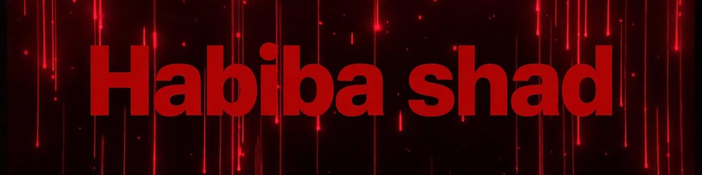

# Habiba Shad | Full Stack Web Developer & BSCS Student

### Building Premium Websites. Creating Luxury Digital Experiences.

 
 

---

## About Me

Hello! I'm **Habiba Shad**, a Full Stack Web Developer and BSCS student at the University of Swat.

I enjoy building modern, responsive and user-friendly websites, creating premium UI/UX designs, and turning business ideas into beautiful digital experiences with clean code.

My goal is to turn technical knowledge into practical, luxury solutions, communicate clearly with clients, and continuously grow through real projects.

**Interests:** Full Stack Development, UI/UX Design, Premium Websites, and Creative Design
**Focus:** Real client projects, clean code, and premium design
**Portfolio:** Business websites, Academy systems and AI projects
**Currently learning:** Advanced React, Modern UI and Full Stack Projects

---

## Featured Projects

### 01 — Al Qalam Learning Academy
**Objective:** Build a complete academy management system to handle students, teachers, courses and results in one premium platform.

**Project highlights**

- Complete student & teacher management
- Courses, results and academy dashboard
- Clean, fast and responsive design
- Real client project built with PHP & MySQL

[Open Portfolio](https://baziracorporation.com/shad/) | [View 【entity-GitHub¦canonical_name=GitHub】 Projects](https://github.com/shads95?tab=repositories)

### 02 — Responsive Business Websites
**Objective:** Build luxury, fast and mobile-friendly websites for businesses to grow their brand online.

**Project highlights**

- Premium, modern and responsive designs
- SEO friendly and fast loading
- Business, Portfolio and E-Commerce websites
- Designs that make clients say WOW

[Open Portfolio](https://baziracorporation.com/shad/) | [View 【entity-GitHub¦canonical_name=GitHub】 Projects](https://github.com/shads95?tab=repositories)

### 03 — Burgundy AI — AI Video Generation
**Objective:** Explore AI + Web to build a next-level AI video generation project.

**Project focus:** AI integration, modern UI, and future-ready web experience.

[Explore Project Repository](https://github.com/shads95?tab=repositories)

---

## Technical Skills

**Frontend:** HTML, CSS, JavaScript, React, Bootstrap
**Backend:** PHP, MySQL, Flutter
**Tools:** Figma, Git, 【entity-GitHub¦canonical_name=GitHub】, VS Code

**Professional skills**

- Clean code and responsive design
- Premium UI/UX and luxury layouts
- Business website development
- Client communication and project delivery

---

## 【entity-GitHub¦canonical_name=GitHub】 Analytics

---

## My Goals

- Build stronger full stack and UI/UX skills.
- Develop professional, client-ready portfolio projects.
- Improve React and modern web capabilities.
- Become a Top Rated Developer on 【entity-Upwork¦canonical_name=Upwork】.
- Create clear documentation and meaningful project reports.

---

## Connect With Me

**📧 shadhouse2004@gmail.com**

---

*Learning continuously. Building practically. Improving every day.*

### ✍️ — Habiba Shad —

**Thanks for visiting! ❤️ Don't forget to ⭐ star my repos**

